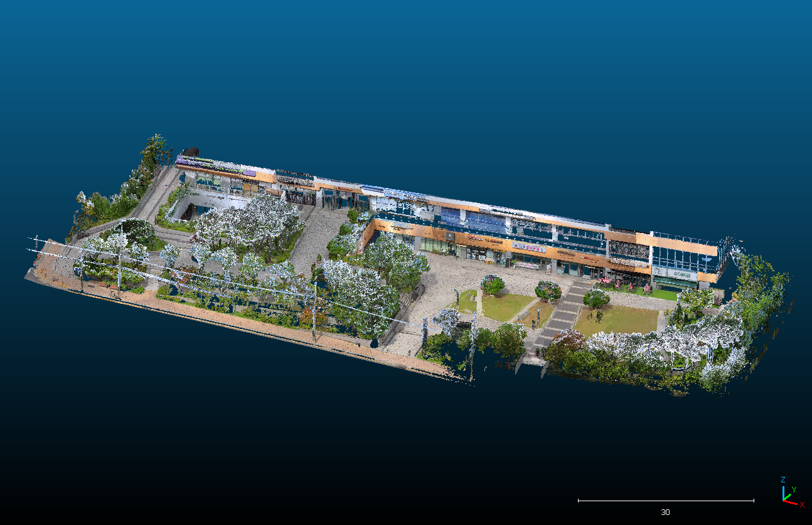
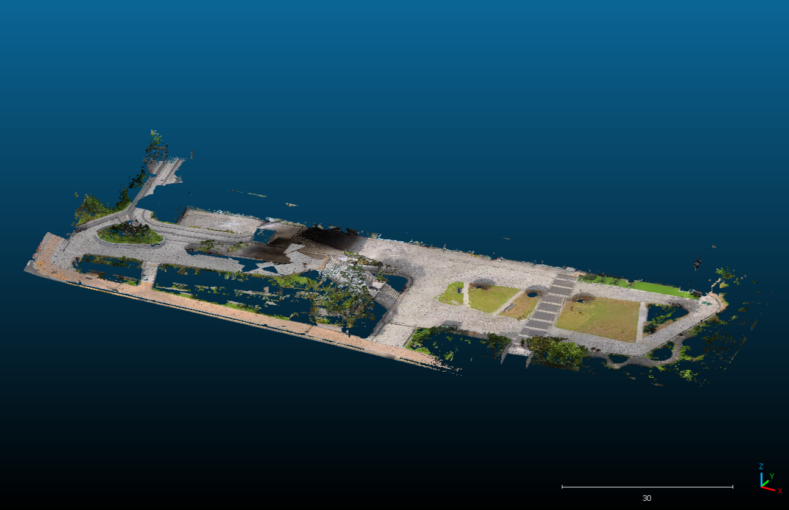
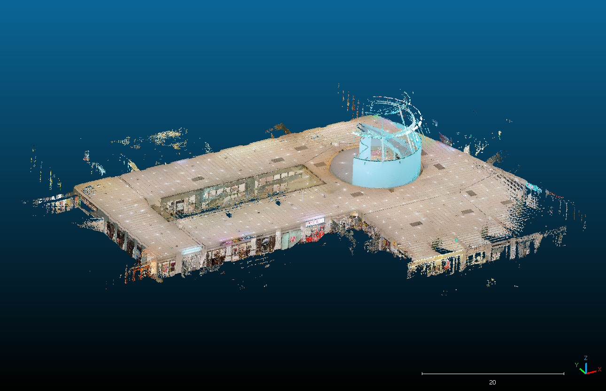
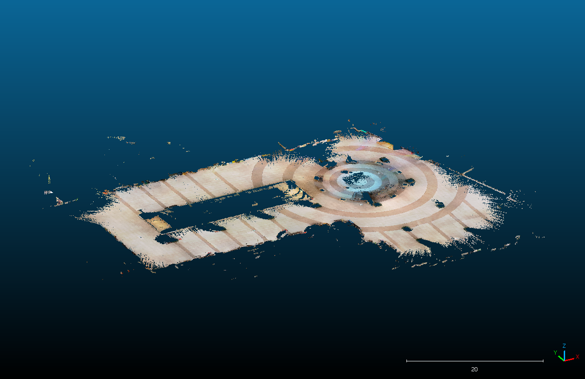
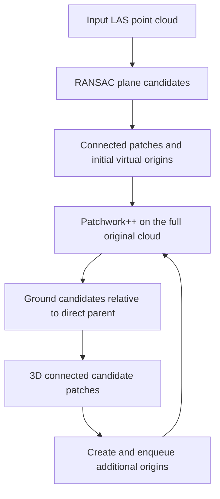
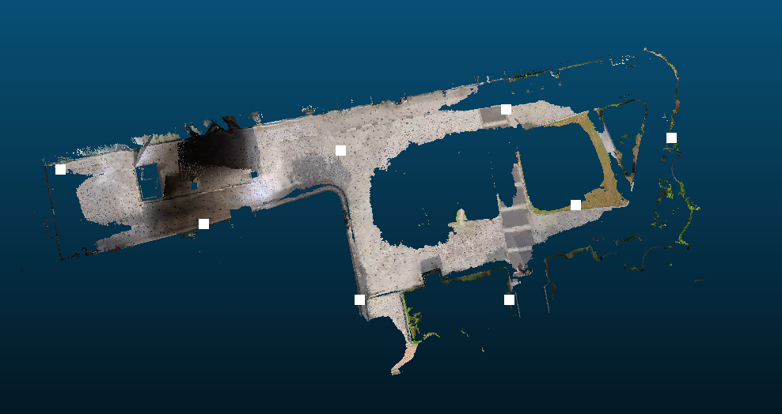

# LiDAR Ground Exploration

**Recursive exploration of ground candidates in LiDAR point clouds using RANSAC, Patchwork++, and automatically placed virtual sensor origins.**

> **Research prototype · Completed November 2026**  
> Explores candidate ground surfaces; **does not yet produce a verified, unified Ground/Non-ground segmentation**.

## Overview

Ground extraction becomes challenging when the acquisition sensor position is unavailable, or when a scene contains multiple floor levels, stairs, slopes, and complex structures. A single plane or a single virtual sensor origin may not cover all ground regions.

This project investigates a geometry-driven way to **place virtual sensor origins automatically and expand the search recursively**. The emphasis is on discovering candidate regions, preserving experimental reproducibility, and identifying where the approach fails—not on claiming a completed segmentation solution.

## Qualitative results

The images below are **illustrative visualizations from the experiments**, not ground truth or an accuracy benchmark. The right-hand views show **ground candidates** observed during exploration; they are **not a final, unified segmentation mask** produced by the pipeline.

**SKV1 — Outdoor mixed geometry**

| Input point cloud | Ground candidate visualization |
|:---:|:---:|
|  |  |

**TerraB1 — Complex indoor environment**

| Input point cloud | Ground candidate visualization |
|:---:|:---:|
|  |  |

**Interpretation:** The indoor scene showed particularly promising candidate coverage by visual inspection. Outdoor scenes exposed false positives and incomplete exploration. These screenshots should not be interpreted as quantitative recall, precision, or proof of complete ground extraction.

## Approach



### 1. Initial plane detection

RANSAC detects a dominant planar candidate from the input point cloud. **Planarity is not semantic ground identification**: a roof or a ceiling can be selected instead of a floor.

### 2. Automatic virtual origin placement

Detected planar inliers are projected to an XY occupancy grid. Connected patches and spatial constraints guide origin placement instead of arbitrary random positioning.

- Occupancy grid: **0.5 m** cells; at least **3 points** per occupied cell
- Connected components: **8-neighbor** connectivity; minimum patch area **10 m²**
- Placement constraints: at least **1 m** from a patch boundary and **10 m** between initial origins
- Assumed sensor height: **1.723 m** above a supporting candidate point (configurable)



*SKV1 example: eight automatically generated virtual origins, displayed as white markers. Their placement demonstrates geometric initialization, not validated sensor pose recovery.*

### 3. Independent Patchwork++ classification

For each virtual origin, Patchwork++ classifies the **entire original point cloud**. Each run retains its own point-index Ground mask. Changing the origin can change the classification, especially around complex geometry and the algorithm's concentric zone model (CZM).

### 4. Recursive candidate exploration

A new origin's Ground candidates are compared with those of its **direct parent**:

```text
new_candidates = Ground(child) - Ground(parent)
```

Supported **3D connected voxel patches** from these parent-relative candidates produce further virtual origins. The exploration repeats through a candidate queue until the queue is empty or a safety execution limit is reached.

**Important:** “New” means new *relative to one parent*, not globally unseen or confirmed ground. The pipeline intentionally does **not** use a union of per-origin Ground masks as the final segmentation.

## Evaluation across scenes

The pipeline was evaluated qualitatively using CloudCompare on four scenes with different spatial structures.

| Scene | Environment | Observation |
|---|---|---|
| **SKV1** | Outdoor plaza, stairs, mixed geometry | Expanded ground candidate exploration; vegetation false positives and declining efficiency in later branches |
| **TerraB1** | Indoor, complex structures | Particularly strong ground coverage by visual inspection |
| **Woolim** | Sloped road and height changes | The initial RANSAC seed corresponded to a ceiling; exploration reached parts of the road, but upper slope coverage remained incomplete |
| **Outdoor Restaurant** | Additional validation scene | Candidate queue exhausted; final ground coverage was not established |

**No annotated Ground Truth was available.** Classified point counts and visual coverage estimates must not be treated as precision, recall, or IoU measurements.

## Getting started

### Prerequisites

- **Python 3.11+** and [uv](https://docs.astral.sh/uv/)
- An authorized **LAS point cloud** with a consistent, meter-based XYZ coordinate system
- Enough RAM and disk space for processing large clouds at their original resolution

This is a script-based project, **not an installable Python library**. The environment is managed by `pyproject.toml` and `uv.lock`.

```shell
uv sync
uv run python scripts/recursive_ground_pipeline_v1.py --help
```

### Step 1 — Generate and inspect initial origins (optional)

```shell
uv run python scripts/recursive_ground_pipeline_v1.py data/example.las outputs/example_run --bootstrap-only
```

Inspect `outputs/example_run/_bootstrap/origins/` in CloudCompare before continuing. A detected planar seed may be non-ground.

### Step 2 — Run the integrated v1 pipeline

```shell
uv run python scripts/recursive_ground_pipeline_v1.py data/example.las outputs/example_run --max-total-executions 96
```

The default processing batch is **32 origin executions per invocation**. Continue with the same input, output directory, and settings:

```shell
uv run python scripts/recursive_ground_pipeline_v1.py data/example.las outputs/example_run --max-total-executions 96 --resume
```

To reuse previously checked initial origins rather than running RANSAC, provide `--initial-origins-csv PATH`. See `--help` for parameters such as `--max-voxels`, `--sensor-height`, `--min-range`, and origin placement limits.

**Resume caution:** Saved state records resolved paths and experiment settings. Relocating the project or changing options can make existing runs incompatible with `--resume`.

### Generated outputs

| Output | Purpose |
|---|---|
| `_bootstrap/` | Initial RANSAC inliers and automatically generated origins (when enabled) |
| `state.json` | Pending queue and saved execution state |
| `lineage.csv` | Origin parent relationships, depth, classification counts, and timing |
| `origins_executed.xyz`, `origins_pending.xyz` | Processed and queued virtual origin coordinates |
| `masks/ground_XXXX.npy` | Packed independent Ground mask per origin |
| `samples/` | Optional LAS samples for qualitative inspection |

## Repository layout

```text
scripts/
├── recursive_ground_pipeline_v1.py   # Recommended standalone entry point
├── experiments/                       # RANSAC, multi-origin, recursive v1/v2 research history
├── diagnostics/                       # CZM analysis and visualization
└── tools/                             # LAS sampling utility

docs/images/                            # Illustrative, qualitative screenshots
```

The earlier recursive v1 and the v2 scheduling experiment remain in `experiments/` to preserve research history. The **integrated pipeline uses the frozen v1 exploration behavior**; it does not incorporate v2's best-first scheduling changes.

## Limitations and research status

This research concluded in **November 2026**. The current prototype has several known limitations:

- **Seed ambiguity:** RANSAC can initialize on a ceiling, roof, or other non-ground plane.
- **False-positive propagation:** Vegetation and structural surfaces can become new exploration seeds.
- **Exploration gaps:** Sloped or multi-level ground may remain partially unvisited.
- **Repeated exploration:** Parent-relative novelty does not remove all overlap between branches.
- **No final classifier:** Per-origin Ground masks are stored independently; no reliable global Ground/Non-ground decision rule has been implemented.
- **No accuracy benchmark:** Ground Truth labels and reproducible quantitative segmentation metrics are unavailable.

A completed queue or execution budget is **not** a guarantee of complete ground coverage.

## Data and reproducibility

The repository is intended to retain **code, configuration, and research methodology**. Original proprietary LAS/PLY files and generated point-cloud outputs are **not included**. The example screenshots above were prepared from experiment visualizations; publish them only where redistribution of such derived imagery is authorized.

The repository records enough information to inspect the implemented method, but an exact reproduction of the original experiments requires the original data, initialization artifacts, environment, and matching parameter choices. Automatic RANSAC results may also differ across library versions or randomization settings.
